# Diagrams

How the pieces fit, drawn rather than described. Each diagram is [Mermaid](https://mermaid.js.org), so it renders on this wiki and in the repository, and each one says which page holds the detail. Screens are in the [Screen gallery](../journeys/screen-gallery).

- [The pieces](#the-pieces) · [The data](#the-data) · [One day's housekeeping: the engine tick](#the-engine-tick)
- [Adding a task](#adding-a-task) · [Night Planning](#night-planning) · [An Anchor's life](#an-anchors-life) · [A focus session](#a-focus-session) · [Access and the trial](#access-and-the-trial)
- [Sync between devices](#sync-between-devices) · [Widgets](#widgets) · [Links and notification taps](#links-and-notification-taps) · [Navigation by device](#navigation-by-device)

## The pieces

Everything that decides something is in **JamaalCore**, a Swift package with no UI. The app and the widget extension are thin: they read the same store and draw. The store lives in the **App Group** container so the widget can read it, and iCloud mirrors it between devices. Detail: [Architecture overview](overview), [Widgets and the watch](widgets-and-watch).

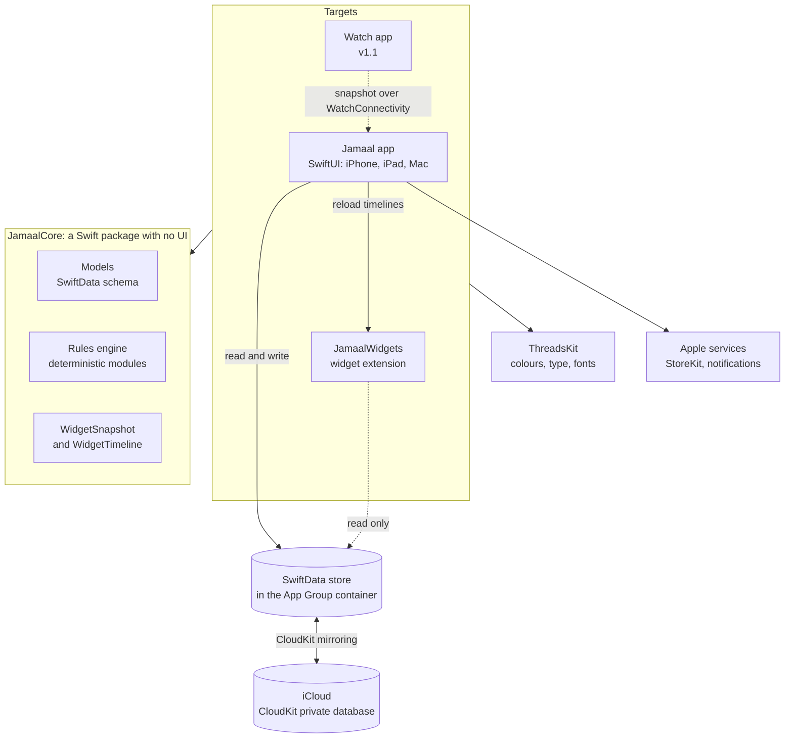

## The data

Three primitives and what hangs off them. A **Task** is something you do, a **Habit** something you cultivate, an **Anchor** something your life moves around: see [Schema overview](../schema/overview) and the pages for [Task](../schema/task), [Habit](../schema/habit) and [Anchor](../schema/anchor). Every relationship is optional and every property has a default, because the store syncs through CloudKit.

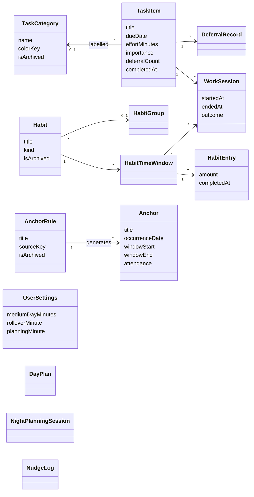

`UserSettings`, `DayPlan`, `NightPlanningSession` and `NudgeLog` stand alone. An `Anchor` with no rule is a one-off. A `WorkSession` belongs to a task **or** a habit window, never both.

## The engine tick

The engine keeps the day current in **one idempotent call**: a second tick over the same moment changes nothing. It runs at launch, whenever the app becomes active, and a few seconds after changes arrive from iCloud. Detail: [Rules engine](rules-engine).

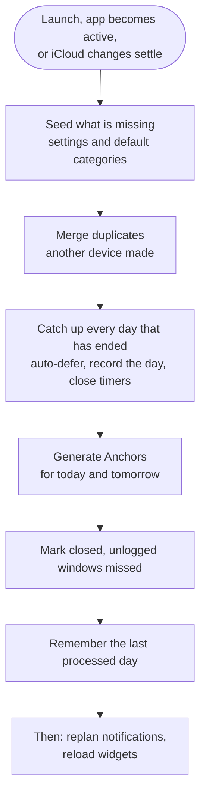

## Adding a task

The form keeps a dated task dated and nudges the date when something matters. Before saving, a full day is noticed and a way out is offered. Detail: [Today list](../journeys/today-list), [Task](../schema/task).

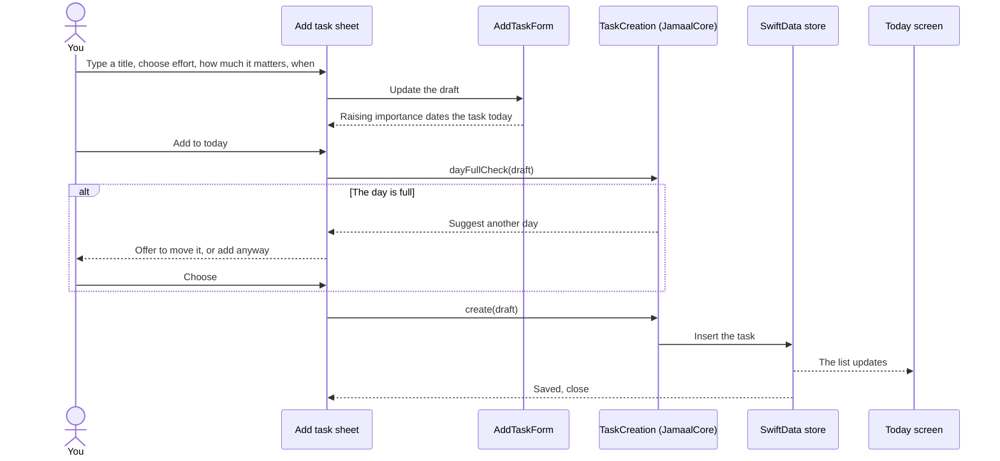

## Night Planning

Five steps, saved as you move, with a way out at every step. Skipping loses nothing. A closed night reopens at Build, and a skipped one starts again at Review. Detail: [Night Planning](../journeys/night-planning).

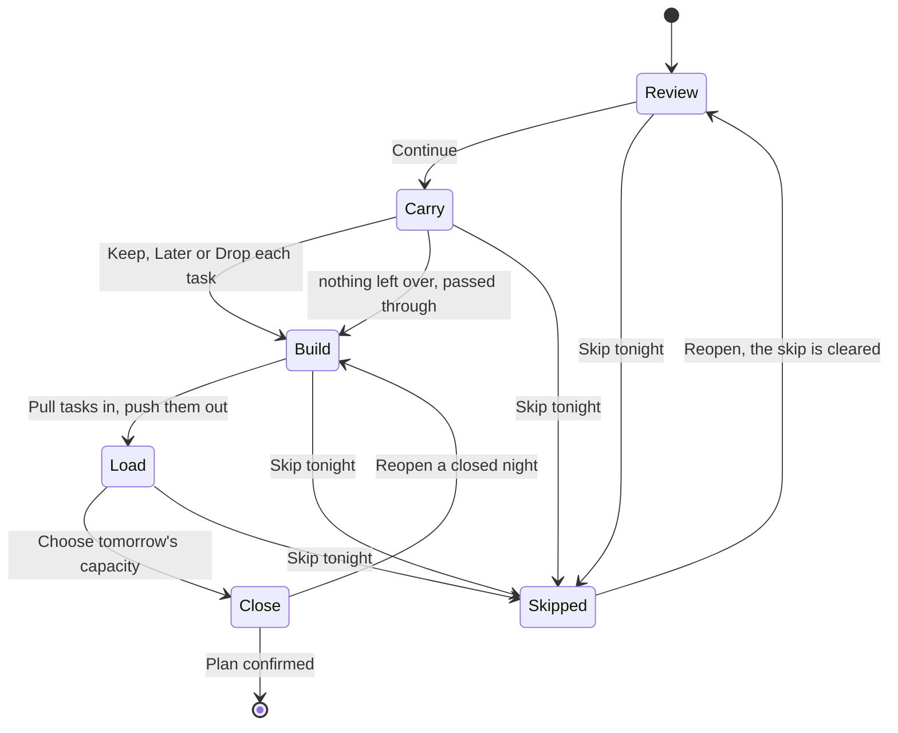

## An Anchor's life

An Anchor has a **window** that is worked out from the clock (never stored) and an **attendance** that is recorded. A missed window is not a failure to hide or to shout about: it reads as a plain fact. Detail: [Anchor](../schema/anchor).

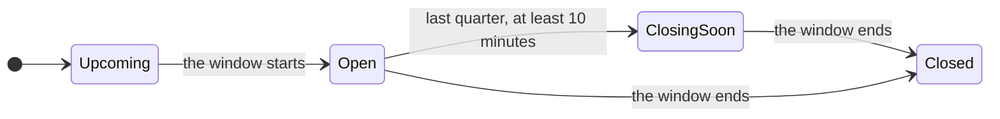

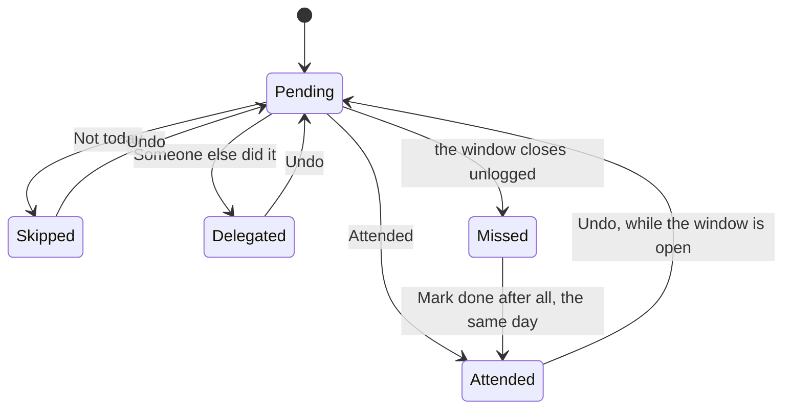

## A focus session

One live session at a time, for a task or a timed habit. Elapsed time is worked out from the start time, so a closed or killed app never loses or invents time. Overrun is a state, not an event: nothing nags. Detail: [Rules engine, module 8](rules-engine#8-focus-sessions-state-machine).

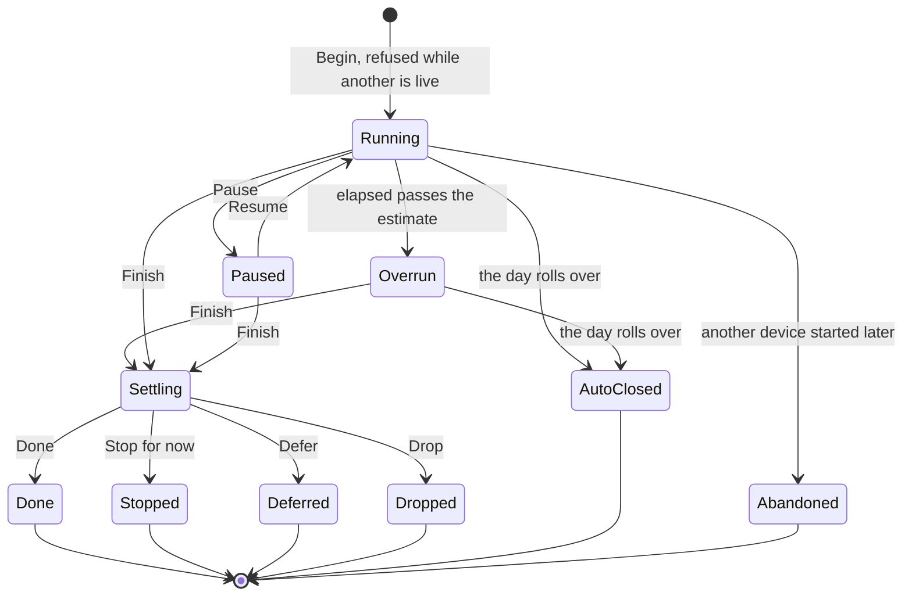

## Access and the trial

The trial is managed by the app, with no payment up front. When it ends without a subscription the app goes **read-only**, never locked: living the day (ticking things off, logging, Anchor outcomes, focus timers, export) always works, while shaping the plan is locked. Detail: [App flow](../journeys/app-flow#trial-and-subscription).

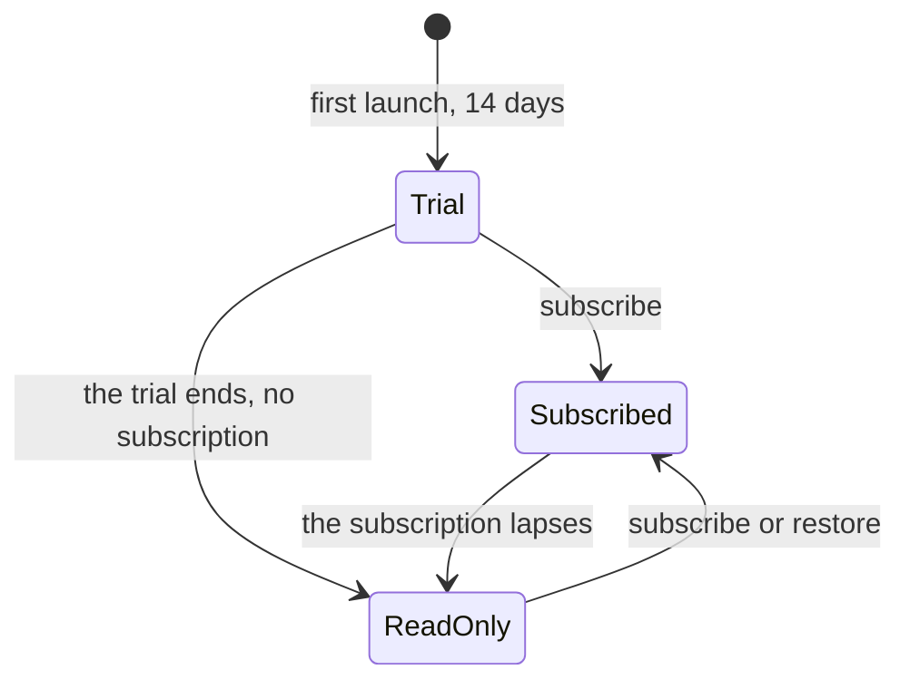

## Sync between devices

The phone, the iPad and the Mac each keep a full copy, and iCloud carries changes between them. Each device seeds the default categories on first launch, so for a moment there are two sets: the engine merges them once the import settles. Widgets are told to reload. Detail: [Architecture overview](overview#sync-243).

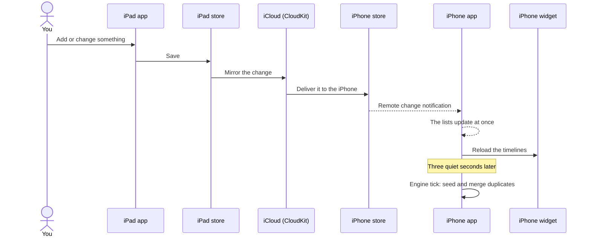

## Widgets

A widget cannot run the app's code, so it works from a small, device-independent snapshot of Today that it builds itself from the shared store, read-only. It plans its own updates (an Anchor opening or closing, the planning time, the day's end) and the app tells it when the data changes. Detail: [Widgets and the watch](widgets-and-watch).

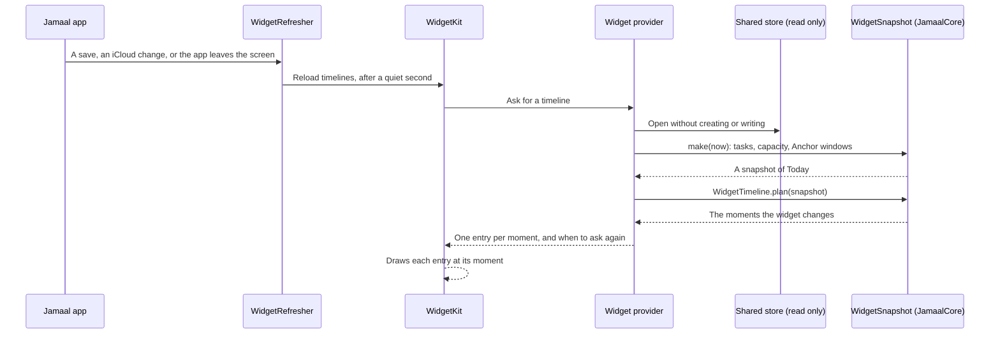

## Links and notification taps

A widget tap and a notification tap take the same path in: both become a route, and the app acts on the route. A link that is not ours is ignored. Planning goes through the same access check as the Plan tomorrow button. Detail: [Widgets and the watch](widgets-and-watch#opening-the-app).

```mermaid
sequenceDiagram
  actor You
  participant Src as Widget or notification
  participant App as Jamaal app
  participant Link as JamaalLink (JamaalCore)
  participant Shell as App shell
  participant Today as Today screen

  You->>Src: Tap
  Src->>App: jamaal://today, plan or task/id, or a notification id
  App->>Link: Parse
  alt Not one of ours
    Link-->>App: Nothing, ignored
  else A route
    Link-->>App: today, planning for tomorrow, or a task
    App->>Shell: Set the route
    Shell->>Today: Show Today
    alt planning
      Today->>Today: Start Night Planning, if the plan may be shaped
    else a task
      Today->>Today: Open that task
    end
  end
```

## Navigation by device

The same sections, shaped by the screen. Anchors are a segment inside Habits on a phone and their own sidebar item where there is room. Detail: [App flow](../journeys/app-flow#navigation).

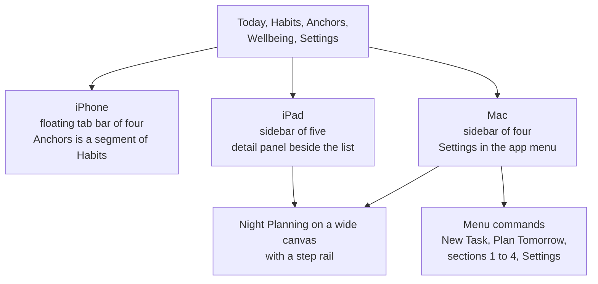
