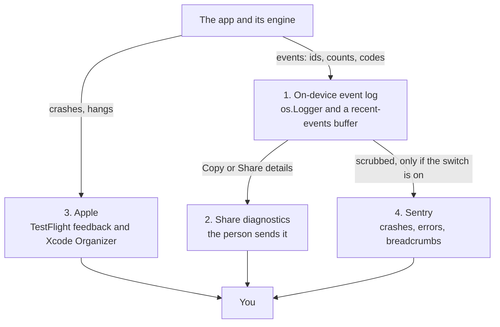

# Observability and debugging

How we find out what went wrong on a device we can't see, without ever collecting what a person plans or does. Decided 21 Oct 2026. **Status: layers 1 and 2 are built (#285); layers 3 and 4 are not.**

The need is real: the problems we have chased so far (a missed *done* overwritten, a habit's minutes not reaching another device) were **not crashes**, so Apple's crash reports would never have shown them, and a device we can't hold in our hands can't be debugged by guessing.

## Principles

1. **Events, never content.** A log line or report may carry an event name, a short id, a count, a duration, an enum value or an error code. It must **never** carry a task, habit, Anchor, category or note title, any text the person typed, a place or location (prayer times use one), or a name.
2. **Two ways out, both chosen by the person:** *Share diagnostics* (they press a button and send the text themselves), and *Share crash and error reports* (a switch, with a plain explanation).
3. **The app works the same with both off.** Diagnostics never block, nag or change behaviour.
4. **Say it truthfully.** The privacy label, the privacy policy, the privacy manifest and *Privacy and your data* must describe exactly what is sent.

## The four layers

| Layer | What it gives | What leaves the device | When |
|---|---|---|---|
| **1. On-device event log** | The story before a problem: sync results, engine ticks, focus finishes, store opens, errors | Nothing | First slice |
| **2. Share diagnostics** | A tester sends one block of text with the version, device, sync state, record counts and the last events | Only when they press it | First slice |
| **3. Apple (TestFlight and Organizer)** | Crashes, hangs, energy and memory, with screenshots and comments from TestFlight feedback | What Apple collects from people who allowed it | Free, from the first build |
| **4. Sentry** | Crashes **and handled errors** (a failed export, an engine invariant broken), with the last events as breadcrumbs, by build | Scrubbed reports, only with the switch on | Second slice, needs the owner's Sentry project |

Layers 1 to 3 need no new dependency. Layer 4 is the only one that adds a package and changes the privacy label.

## What may be logged

A fixed set of **categories**, each an `os.Logger` category in the subsystem `dev.fhdamd.Jamaal`: `sync`, `engine`, `focus`, `anchors`, `habits`, `widgets`, `store`, `notifications`, `purchases`.

| Allowed | Never |
|---|---|
| `engine tick: seeded 0, merged 2, generated 3, finalised 0, 41 ms` | `finished "Draft the architecture review"` |
| `sync import ended ok, 12 s ago` / `export failed: CKError 9` | the text of a note, a title, a category name |
| `focus finish: habit window 3f9a, 7 min, entry written` | a place or coordinates, or a prayer time's city |
| `store open failed: <error domain and code>` | a person's name, an iCloud account name or email |

Ids are the first four characters of a UUID, enough to compare two devices and not enough to identify anything. **A message is built from typed fields, not interpolated strings**, so a title can't be logged by accident; the log type only accepts events, and a test checks that no event's text contains a sample title.

## Layer 1 and 2: the on-device log and Share diagnostics

- **`DiagnosticEvent`** (JamaalCore, pure and tested): a time, a category, a level, a name and typed details. A **ring buffer** keeps the last 200 in memory and, on the device only, a small file, so a launch after a crash still has the events before it.
- **`Diag`** in the app: one call writes an event to `os.Logger` (so Console and sysdiagnose see it) and to the buffer.
- **Hooks** (built) at the places that have already caused trouble: the sync events (`SyncMonitor`), the engine tick and its report, focus finish and the minutes it wrote, Anchor finalising, store open and recovery, notification scheduling, widget reloads.
- **Copy details / Share details** (Settings → iCloud sync, later *Privacy and your data*) now include: app version and build, iOS or macOS version, device model, whether this is a TestFlight build, the sync status, the record counts, and the last 50 events. One tap opens the system share sheet to email it to support.

## Layer 4: Sentry (with the switch)

Chosen over the alternatives because it reports **handled errors and breadcrumbs**, not only crashes, can be configured to collect no personal data, and has an EU region. It is the only third-party code in the app, so it is configured to collect as little as it can:

| Setting | Value | Why |
|---|---|---|
| Send personal information, IP address | **off** | No user, no address |
| Screenshots, view hierarchy | **off** | They can show a task's text |
| User-interface breadcrumbs (taps) | **off** | They record button and row labels, which are task titles |
| Performance traces, profiling, session replay | **off** | Not needed, and more data |
| Release health sessions | **off** at first | Counts only, but a usage signal; revisit |
| Breadcrumbs | **our own events only** | Already free of content |
| `beforeSend` and `beforeBreadcrumb` | **drop or blank any message not built from our event type** | A second guard in case something slips |
| Region | **EU** (`de.sentry.io`) | Sentry offers the EU or the US; the EU keeps the data under European data-protection rules |

**The switch.** *Share crash and error reports* lives in *Privacy and your data*. It is **on by default in TestFlight builds** (the explanation is shown in the test notes and the first time the person opens the setting) and **off by default in an App Store build until it is decided again**; either way it is one tap to change, and turning it off stops the SDK at the next launch. It is never started at all while the switch is off.

## What changes for privacy, when layer 4 ships

- **App Store label:** from *Data Not Collected* to *Data Not Linked to You*: **Diagnostics** (crash data, performance data, other diagnostic data), purpose **App functionality**, **not used for tracking**.
- **`PrivacyInfo.xcprivacy`:** the collected data types are declared (crash data, performance data, other diagnostic data, not linked, not tracking, app functionality). Sentry ships its own manifest as well.
- **Privacy policy** (https://jamaal.app/privacy) and **`YourDataScreen`'s statement** gain a paragraph saying what is sent, that it contains no tasks, habits, notes or places, who receives it, and how to turn it off.
- The TestFlight readiness answers are updated at the same time. Until this ships, the answers stay *Data Not Collected*.

## Slices and status

| # | Slice | Needs | Status |
|---|---|---|---|
| 1 | `DiagnosticEvent`, the ring buffer and the report text (JamaalCore). An event is a fixed name with fixed keys and values that can only be a count, a flag, a four-character id or an error's domain and code, so no title can be logged | nothing | **built (#285)** |
| 2 | `Diag` and the hooks (launch and activity, store open, the engine tick, iCloud setup/import/export, focus begin and finish with the habit's day total, widget reloads); version, build and channel, device and the last 50 events in Copy details; *Share details* | nothing | **built (#285)** |
| 3 | Apple tools checked on the first TestFlight build (feedback on, Organizer visible) | the first beta | planned |
| 4 | Sentry: the package, the configuration above, the switch, the manifest, the label, the policy and the in-app text | **a Sentry project and its DSN from the owner** | planned, blocked on that |

## Open decisions (owner)

1. The Sentry plan and its **region** (EU proposed). The free plan has a monthly cap on errors, which is plenty for a beta.
2. Whether the switch is **on by default in TestFlight builds** (proposed) or asked once at the end of onboarding.
3. Who receives *Share diagnostics*: a support address on `jamaal.app` (needs to exist before the first beta).
