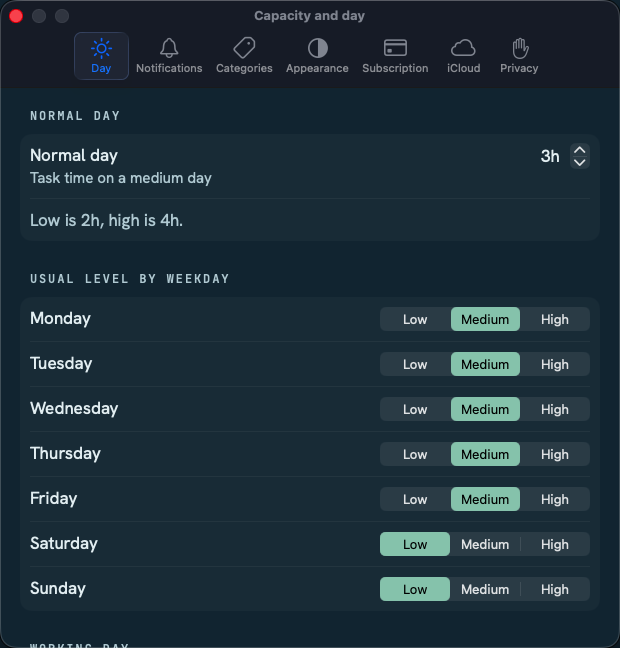
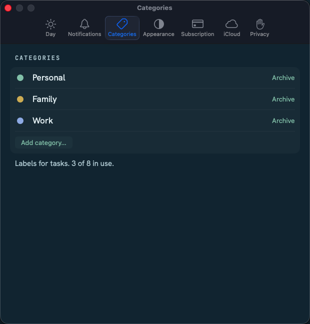
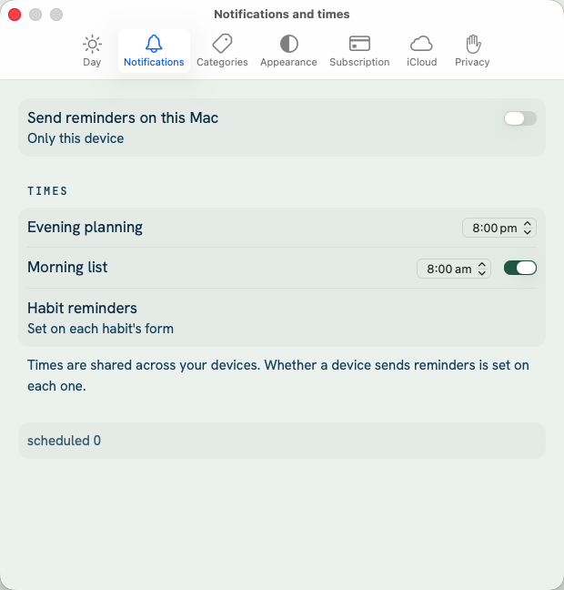
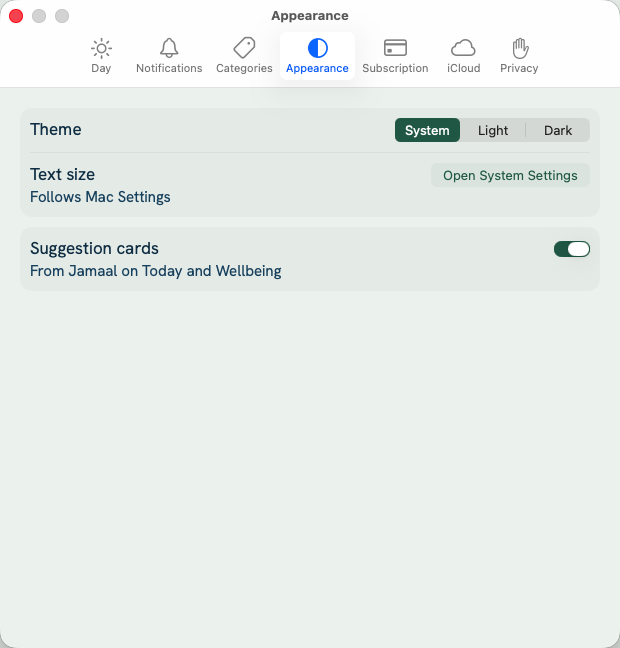

# Mac Settings window

Where Settings lives and how it looks on the Mac (#365). There is **no Mac Settings frame** in Design v4 (the only Mac frame is task detail), so this page records the decisions, taken from three places: Apple's Human Interface Guidelines, the Design v4 handoff, and what the app already does.

## What we are fixing

On the Mac, ⌘, used to switch the main window to the iPhone-style Settings list (a pane in the window, with the iPhone's header space and a floating back circle). The native toggles, pickers and date pickers inside it rendered at small AppKit sizes in 60 pt iPhone rows, next to touch-sized steppers and colour dots: small, and off the design system.

## Decisions

| | Decision | Why |
|---|---|---|
| Where | A separate **Settings window**, opened by *Jamaal → Settings…* (⌘,). The main window has no Settings pane on the Mac. | HIG ([Settings](https://developer.apple.com/design/human-interface-guidelines/settings)): the App menu's Settings item opens a custom settings window with a toolbar that switches between panes. Design README: *on Mac it moves to the app menu (`Settings` scene, ⌘,)*. |
| Structure | A toolbar of **panes**, one per row of the iPhone and iPad Settings list, in the same order: Day, Notifications, Categories, Appearance, Subscription, iCloud, Privacy. | Same information architecture on every platform; nothing is renamed or regrouped without Design. |
| Window | Fixed width (about 600 pt), height fits the pane. Minimize and zoom are dimmed. The title is the pane's full name (*Capacity and day*, …). The **last pane used is restored**. | HIG: a settings window fits the current pane, dims minimize and maximize, shows the pane's title, and opens at the last pane. |
| Controls | Native Mac controls at their **regular** size in grouped forms: switches or checkboxes as the HIG describes (a mini switch within a grouped form, a checkbox for a hierarchy of settings), segmented pickers, compact date pickers, steppers. Tinted with the palette's `accent`. **No touch-sized custom controls** (44 pt steppers, 52 pt colour dots). | HIG ([Toggles](https://developer.apple.com/design/human-interface-guidelines/toggles)); Design README: Mac density 32–40 pt rows, 15 pt body, 28 pt pointer target. |
| Look | The page ground is `threads.app`; text uses the type roles (`row`, `body`, `meta`); there are no glass circles, no big page title (the window title does that job), no `pageTitle` or 76 pt header space. | Same tokens as everywhere (Design README: *Mac density … same tokens*). |
| Reaching a pane | Anything in the main window that opened Settings on the Mac opens this window at the right pane: ⌘, , the Subscribe route from a notification or widget, the iCloud hint. | One way in. |
| Access rules | The Settings window applies the same trial and read-only rules as the main window (changing the day or the categories when read-only shows the calm locked sheet). | Settings is not a way round read-only. |

iPhone, iPad and Duo keep the Settings list and pushed pages exactly as they are.

## As built (slice 2, #367)

Screenshots from the Mac UI tests (Dark appearance). The window is 620 pt wide; the form scrolls inside it.

- **Capacity and day:** the normal day is a system stepper; each weekday is a segmented Low / Medium / High picker (the weekday is its label, written once); the working day is two field date pickers; the rollover is a menu.
- **Categories:** the name is edited in place (Return saves; a refused name, blank or a duplicate, goes back); the dot opens a menu of the five colours; Archive is on the row; rows reorder by dragging or from the right-click menu; Add category sits under the list; Archived is a disclosure group with Restore.
- Same access rules as before: a locked action shows the calm locked sheet.

## As built (slice 3, #368)

Light appearance this time.

- **Notifications and times:** a system switch for this Mac's reminders (it asks for permission when first turned on); the evening planning and morning times are field time pickers, with the morning time shown only while its switch is on; the warning card (when reminders can't arrive) is a section with a prominent button.
- **Appearance:** the theme is a segmented System / Light / Dark picker; Text size opens System Settings; suggestion cards is a system switch.

## Slices

1. The window, ⌘,, routing, last pane restored, access rules, panes show today's screens (#366).
2. Capacity and day, and Categories as Mac forms (#367): done.
3. Notifications and Appearance (#368): done.
4. Subscription, iCloud sync and Privacy and your data (#369).
