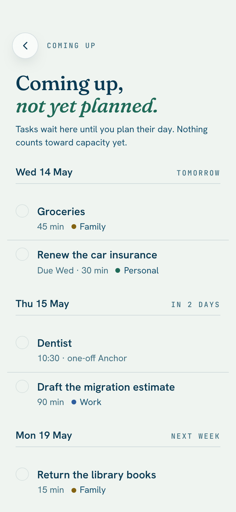
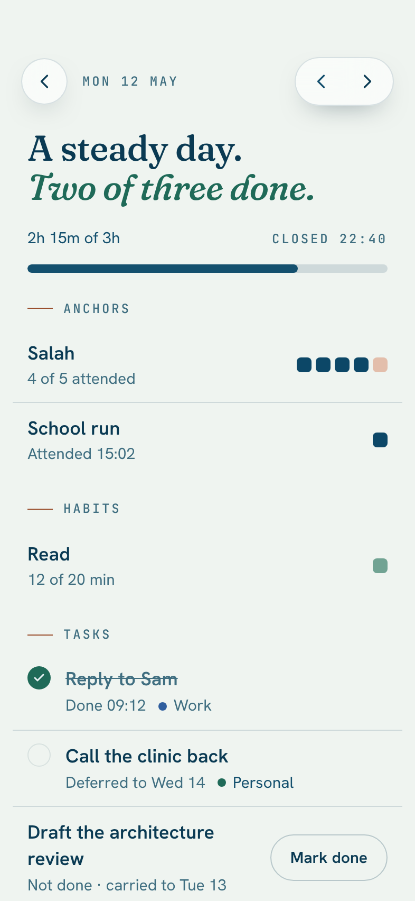
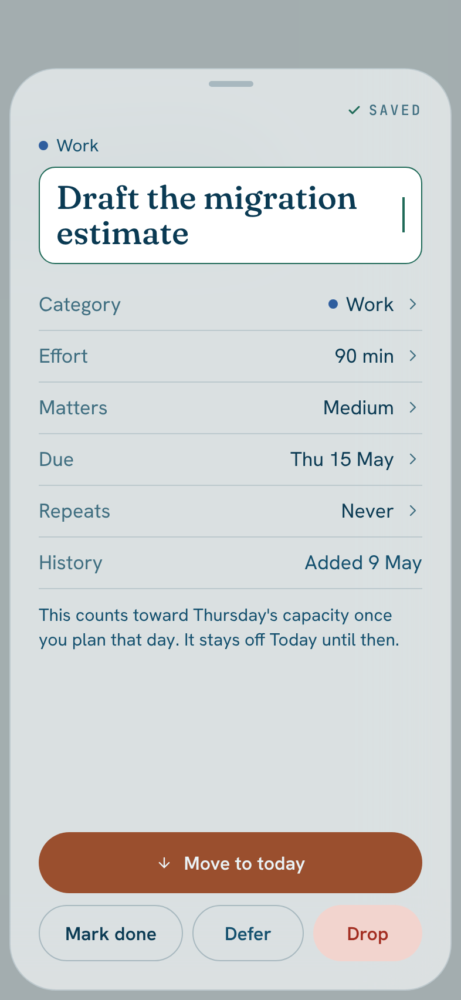
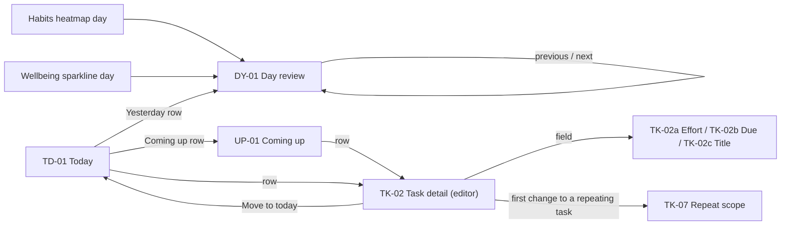

# Coming up, Day review and editing a task

Added by the v1 enhancements pass (#382); decisions and the differences from Design's handoff are in [v1 enhancements reconciliation](../design/v1-enhancements-reconciliation). Frames: [`mockups/screens/10-v1-enhancements/`](../../mockups/screens/README#10-v1-enhancements-november-2026).

  

## Rules that apply everywhere

- **Capacity counts planned days only.** A future-dated task counts toward no day's capacity until its day is planned (Night Planning, or the morning flow, or *Move to today*). Coming up shows no capacity bar.
- **No edit mode.** Task detail *is* the editor: every field edits in place and autosaves; there is no Edit, Save or Cancel. A `Saved` tick in the header confirms.
- **Undo instead of Cancel.** Leaving a task you changed shows an undo toast for 5 seconds; Undo reverts every change made in that visit. Mac also has ⌘Z.
- **One terracotta fill per surface.** On a future task the primary is **Move to today**, which replaces **Begin**.
- **Selected row** is a white fill with a 1.5 pt ink ring, never terracotta.
- **Past days are read-only**, except that a missed **task** can be ticked for **two days** (habits keep their 14-day correction, Anchors their own rule).
- **Repeating tasks ask once** per visit: this and later, or only this one.

## Today's two rows (TD-01)

Under the task list, in this order: *Also today*, **Yesterday**, **Coming up** (past above future).

- **Yesterday · {done} of {planned} done** when yesterday was a planned day; **Yesterday · not planned** when it was not (still tappable); hidden only when there is no data at all.
- **Coming up · {n} next 14 days**: tasks due after today plus one-off Anchors in the next 14 days. At zero it reads **Coming up · nothing scheduled** and stays tappable, so people learn where future tasks go.

## Coming up (UP-01)

> **Built (slice #385):** Today's **Coming up** row and the Coming up screen. The row pushes the screen inside Today's list column, so on a Mac, iPad and Duo it already takes that column; a task opens in the existing detail sheet until the editor (#387) and wide layouts (#389) arrive. The **Yesterday** row is added with Day review (#386), so that no row is a dead end. A one-off Anchor shows no tick here (attendance is marked on Today while its window is open). `-JamaalComingUp` adds sample tasks dated later.

- Grouped by day for the next 14 days; the relative label (Tomorrow, In 2 days, Next week) on the right of each day header. Anything later goes into a collapsed **Later · n**.
- Rows show effort; one-off Anchors show their time and "one-off Anchor". A repeating task shows its one live instance. Backlog tasks (no date) are not here.
- Rows are dimmed (checkbox ring only; text contrast stays at 4.5:1 or better) because they aren't actionable yet, but the checkbox works: marking a future task done is allowed.
- Copy: *"Nothing here counts toward capacity until you plan its day."*

## Day review (DY-01)

> **Built (slice #386):** Today's **Yesterday** row (above Coming up) and the Day review screen, with arrows between days (the day changes in place; previous goes back to the first day with data, next stops at yesterday), **Mark done** inside the two-day window, and the footer. Anchors read one row per rule ("4 of 5 attended" with a square each). `-JamaalPastDays` adds sample past days. **Not yet:** the entries from a Habits heatmap day and a Wellbeing sparkline day. The heatmap's day tap already opens the habit's 14-day correction, so a second action there needs a small design decision; it follows with the wide layouts (#389).

- Header: the date (mono eyebrow) and previous and next arrows; **next stops at yesterday** (today has its own screen) and **previous goes back to the first day with data**. On Mac, ⌘[ and ⌘] do the same.
- Hero, two lines, the second in italic accent ("A steady day. / Two of three done."); capacity used against set, with **Closed {time}** when the day was closed in Night Planning.
- **Anchors**: attended count, one square per occurrence (attended and missed shaded differently). **Habits**: progress, one square. **Tasks**: done ones struck through with the time done; deferred ones "Deferred to {date}", dimmed; automatic ones "Not done · carried to {date}"; an outlined **Mark done** on a not-done task only inside the two-day fix window.
- Footer: *"Past days are read-only. A missed task can be ticked for two days."* (Habits keep their 14-day correction from the heatmap, and Anchors "Mark as done after all"; only tasks get Mark done here.)
- A task ticked from here is recorded on **that** day (see the reconciliation, decision 9).
- Entry points: the Yesterday row, a Habits heatmap day, a Wellbeing sparkline day. iPhone: swiping right on Today is an optional shortcut to Yesterday.

## Task detail as the editor (TK-02)

> **Built (slice #387):** the detail is the editor. Fields edit where they stand and save (`Saved` tick; no Edit, Save or Cancel); the title has a persistent tinted box; rows for Category, Effort, Matters, Due and Repeats open a picker (**pushed inside the sheet on a phone, a popover on the row beside the list**); a future task shows **Move to today** instead of Begin (a full day offers another day first, as Add does) and its "counts toward {weekday}" note; **one undo toast per visit** names the change ("Call the clinic back · now 30 min"; several changes read "2 changes") for 5 seconds. Mark done, Defer, Drop and Begin end a visit without an undo, since they are not edits. The calendar in the Due picker is the system one for now (Monday-first and the terracotta Today ring come with it; the custom grid in the frame is not built). **Not yet:** the repeat-scope sheet (#388), Duplicate, popovers anchored to the exact row on every wide layout, Duo's push-in-the-right-half and the Mac shortcuts (#389).

- Header: grabber (iPhone sheet), `✓ Saved`, and a **More** menu (Duplicate, Move to another day; also Drop on Duo).
- Category line, then the **title**: plain serif text with a **persistent faint tinted box** so it reads as editable; tapping focuses it (outlined, 1.5 pt accent border). On iPhone the sheet then goes full height above the keyboard (**TK-02c**); the header reads *Editing title* with **Done**, and Return also ends editing. It saves continuously; an empty title on blur reverts.
- Rows, each with a chevron: **Category, Effort, Matters, Due, Repeats**, then **History** (read-only). Effort (**TK-02a**): 15 min, 30 min, 45 min, 1 h, 90 min, 2 h, then **Other…**; choosing saves and closes. Due (**TK-02b**): Today, Tomorrow, the current due weekday, Next week, No date (hidden for medium and high importance), then a month grid from Monday; Today has a terracotta ring, the chosen date is filled ink, past dates are disabled; choosing Today is the same as *Move to today*.
- A future task says *"This counts toward {weekday}'s capacity once you plan that day. It stays off Today until then."*
- Actions: a future task shows **Move to today** (terracotta) then Mark done · Defer · Drop; a task for today shows **Begin** instead. One row on Mac; stacked on iPhone, iPad and Duo (primary full width). *Move to today* counts against today's capacity, and if that overflows it uses the existing "Day is full" handling.
- Pickers: iPhone and Duo folded push inside the sheet's navigation stack; iPad and Mac use a popover anchored to the row; Duo inner pushes inside the right half with a back button. Mac: arrow keys move, Return chooses, Esc closes; Return with a task selected starts editing its title.

## Repeat scope (TK-07)

> **Built (slice #388):** the sheet asks once per visit when title, effort, matters or category of a repeating task is changed; the change is made only once it is answered, so **Cancel (or swiping the sheet away) leaves the task exactly as it was**. *This and later* is the plain edit, because the one live instance is the template the next one copies. ***Only this one*** makes the next instance now from the task as it still is, then this occurrence leaves the series (it stops repeating and loses its `seriesID`), so the series carries on unchanged and there is still exactly one live instance. That needs **no new field and no schema change**. Undo for the visit takes the extra instance away again (unless it has been touched) and puts the series back; the undo toast names the edit, not the stopped repeat. Due and Repeats changes are not asked: a date moves this occurrence, and Repeats is the series itself. The Repeats row now reads "Weekly on Thursday".

On the first change to a repeating task in a visit: eyebrow with the rule ("Weekly on Monday"), "Change just this one, / or every one after?", one sentence naming the change ("Effort goes from 30 to 45 min."), then **This and later {weekday}s** (terracotta), **Only this {weekday}** (outlined) and **Cancel** (text; reverts the change). Asked once per visit; the answer is part of that visit's undo group. A sheet on iPhone, a centred 540 pt sheet on iPad (480 on Mac), a bottom sheet over the right half on Duo.

## Morning, scheduled tasks (TD-07)

> **Built (slice #388):** the existing morning card names the tasks that were scheduled for today ahead of time (live, due today, made before today, not carried by the rollover or a deferral): "No plan for today. 2 tasks are scheduled for it, so two minutes to confirm?" **Pick for today** and **Not now** are as before. There is **no separate "Scheduled for today" section**: a task due today is already on Today's one flat list (grouping it would add a second axis), so *Not now* simply leaves them where they are. `-JamaalScheduled` and `-JamaalRepeating` add sample tasks for these.

The morning after a skipped night, when tasks are scheduled for today: hero "{Weekday}, / unplanned.", the card *"No plan for today. {n} tasks are scheduled for it, so two minutes to confirm?"* with **Pick for today** (the shortened morning flow, those tasks offered) and **Not now** (dismisses for the day; the tasks stay under *Scheduled for today*). On wide layouts the detail column says "Nothing selected" until a task is chosen.

## Undo toast (SY-03)

A pill on `--deep` with `--onAccent` text, "{Task title} · {what changed}", and an outlined **Undo** (Mac shows ⌘Z beside it). It appears after the sheet closes (iPhone) or when you leave an edited task (wide layouts), above the tab bar on iPhone and at the foot of the list column elsewhere; 5 seconds, longer while VoiceOver is on it; not shown if nothing changed; announced as a status update.

## Accessibility

Every control is a real button; icon-only buttons are labelled (Back to Today, Previous day, Next day, Mark done, More, Back to task). Picker options expose a selected state. Touch targets 44 pt or more, except Mac's 28 to 32 pt pointer targets.
