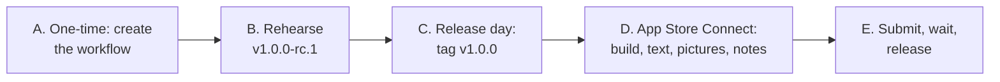

# Release day runbook

How to take Jamaal's **first App Store release** from "main is green" to "submitted for review", in order. It builds on [Release process](release-process) (the design) and [App Store listing](app-store-listing) (the text); this page is the checklist you follow. Written for 1.0 (#414); later releases skip the one-time parts.

**The one thing that can go wrong without anyone noticing:** the release build is marked as an App Store build by `ci_scripts/ci_post_clone.sh` when the tag starts with `v` (#346). If the mark does not take, the build behaves like a TestFlight beta (full access, no trial, no paywall) and App Review sees an app that never asks for payment. **No `v` tag has ever been run**, so this is rehearsed first (Part B) before the real tag.



## Before anything: is it ready?

- [ ] **Main is green** (CI, Docs check) on the commit you will tag, and the pull-request checks were green too.
- [ ] **CloudKit schema:** every model change since the last deployed schema has been **deployed from Development to Production** in the CloudKit console, and the new fields are there. *This cannot be undone.* Betas already use Production, so if the betas sync, most of it is there; look for anything pending anyway.
- [ ] **Version:** the marketing version is the one you mean (`1.0`); it is changed by hand, only when a new version starts.
- [ ] **Subscriptions** are *Ready to Submit* in App Store Connect and in the group **Jamaal** ([setup](release-process#subscriptions-setting-them-up-in-app-store-connect)).
- [ ] **The website is live:** `https://jamaal.app/privacy` and `https://jamaal.app/support` open (the app and the listing link to both).
- [ ] **The pictures exist** (#362) and the listing text is ready.
- [ ] **VoiceOver listened to** on a real iPhone, and the accessibility audit re-run on a real device ([accessibility](../architecture/accessibility)).

## A. One time: create the App Store release workflow in Xcode Cloud

The beta workflow already works (nine betas). The release workflow is a copy with a different tag rule and **no external testing**. In Xcode:

1. **Open the project** (`Jamaal/Jamaal.xcodeproj`), then **Product → Xcode Cloud → Manage Workflows…** (or the **Report navigator**, ⌘9, then the **Cloud** tab).
2. **Start from the beta workflow.** Select it and use **Duplicate Workflow** if it is offered (it keeps the environment, the scheme and both archives). If not, **Create Workflow** and follow the table below. Name it **App Store release**.
3. **Set it up exactly like this:**

   | Setting | Value |
   |---|---|
   | **Environment** | Xcode **Latest Release**, macOS **Latest Release** (the same as the beta) |
   | **Start Conditions** | **only** *Tag Changes*, **name starts with `v`**. Delete any *Branch Changes* or *Pull Request* condition (branch changes would build and upload on every merge) |
   | **Actions** | **Archive · iOS** and **Archive · macOS**, scheme **Jamaal**, each with **Distribution Preparation = App Store Connect** (**not** "TestFlight (Internal Testing Only)": that choice cannot be undone for that build) |
   | **Post-Actions** | **TestFlight Internal Testing** to **your** internal group only. **No** External Testing. (App Store Connect still receives the build; you submit it by hand.) |
   | **Tests** | none (the checks ran on the pull request) |

4. **Check the beta workflow was not changed** by the duplication: its Start Condition must still read *starts with `beta-`*. The two rules cannot match the same tag.
5. **Save.** Xcode Cloud may ask you to allow access to the repository again; allow it for `fahadahmed/jamaal-app` only.
6. **Check the script will run.** `ci_scripts/ci_post_clone.sh` must be executable (it is: mode 100755) and in `ci_scripts/` at the repository root. Xcode Cloud runs it automatically after cloning; there is nothing to switch on. Its job is the one line that matters: *Tag v…: marked this build as an App Store build*.

**Do not** use *Start Build* from the Cloud tab to test the workflow: a manual build is made from a branch, has no `CI_TAG`, and so would not be marked. Test it with a tag (Part B).

## B. Rehearse with a release-candidate tag

A tag such as `v1.0.0-rc.1` matches `v` and `v[0-9]*`, so it runs the real path. It uses up a build number, which is harmless.

1. **Tag a green commit on `main`:**
   ```
   git fetch --tags
   git tag -a v1.0.0-rc.1 <commit> -m "Release candidate 1"
   git push origin v1.0.0-rc.1
   ```
2. **Watch it** in Xcode's Cloud tab (or on the commit in GitHub). In the **post-clone log** look for *Tag v1.0.0-rc.1: marked this build as an App Store build.* If you see *"is not a v<version> tag: leaving the build unmarked"* the mark did not take: stop and fix `ci_post_clone.sh` before anything else.
3. **Wait for App Store Connect to process it** (a few minutes), then install it from **TestFlight** on your devices (internal group).
4. **Check it behaves like the App Store, not a beta:**
   - **Settings → Subscription** does **not** say *BETA* or *Beta · full access*. It says *Free trial · N days left*, *Trial ended*, or *Subscribed*.
   - **See plans** shows the two plans with their real prices ($24.99 a year, $2.99 a month), and the renewal terms and the two links (Terms of Use, Privacy Policy) are on the paywall.
   - **Buying** works through the sandbox, **Restore purchases** works, and after buying the screen says *Subscribed*.
   - **Sync** still works on the Production container (add something on one device, see it on another).
5. **Expect your own account to be past the trial.** The trial starts from StoreKit's original-download date, else the synced first-launch date, and you have had betas on this Apple ID and iCloud since October. So on *your* devices the rehearsal build will probably open as **Trial ended** (read-only, with the paywall). That still proves the marker, the paywall and the purchase. To see **the trial itself** (the banner, "14 days left"), use an **Apple ID that has never installed Jamaal** as an internal tester (App Store Connect → Users and Access).
6. **If anything is off**, fix it on a branch through the normal issue and PR, and run another `-rc.N`.

## C. Release day: tag

1. **Re-check "Before anything"** above, on the commit you will tag.
2. **Tag it** (the tag name is the version you are shipping):
   ```
   git fetch --tags
   git tag -a v1.0.0 <commit> -m "Jamaal 1.0"
   git push origin v1.0.0
   ```
3. **Watch the run** as in Part B, including the *marked this build as an App Store build* line.
4. **A tag push can be missed** (it happened once, on `beta-1.0-4`). If nothing starts within about ten minutes, **delete the tag** (`git push origin :refs/tags/v1.0.0` and `git tag -d v1.0.0`) and **push it again on the same commit**.

## D. App Store Connect

On the app's page, under the **1.0** version:

1. **Build:** choose the build from the `v1.0.0` tag (not a beta or an rc). If it is missing, it is still processing.
2. **Text:** paste the blocks from [App Store listing](app-store-listing): subtitle, promotional text, description, keywords, What's New, URLs, copyright.
3. **Pictures:** upload the finished screenshots (iPhone 6.9", iPad 13", Mac); previews are optional.
4. **In-App Purchases and Subscriptions:** add **both** plans to this version, each with its review screenshot (the paywall, retaken from this build) and its note.
5. **App Privacy:** **Data Not Collected**. **Age rating:** 4+. **Category:** Productivity. **Pricing:** free. **Availability:** the countries you choose.
6. **App Review information:** contact details, and the **review notes**: the app has no account and needs no sign-in; the 14-day trial is managed by the app (no payment up front); after it, the app is read-only until subscribed; purchases in review use the sandbox; a note on iCloud sync needing nothing from the reviewer. Contact support@jamaal.app.
7. **Release option:** *manually release* (recommended for the first one, so you choose the moment) or automatically; and whether to use a **phased release** over seven days.
8. **Add for Review**, check the summary for red warnings, then **Submit for Review**.

## E. After submitting

- Review usually takes a day or two. Watch for a message from App Review; answer in the **Resolution Center**.
- **If it is rejected**, read the reason, fix it on a branch, and tag the next candidate (`v1.0.1`, or `-rc.N` first if it is risky). A reply in the Resolution Center is enough when nothing needs changing.
- **When it is approved,** release it (or it releases itself), then: check it is live, install it from the store on a clean device, and update the docs (`Status` in the release process and this page).
- **The `v` tag marks what shipped**, so a hotfix branches from it ([Hotfixes](release-process#hotfixes)). A fix that touches a model needs the CloudKit deploy step first.

## When something goes wrong

| What you see | What to do |
|---|---|
| No build starts after the tag | Wait ten minutes, then delete the tag and push it again on the same commit. Check the workflow's Start Condition reads *starts with `v`*. |
| The post-clone log says the build was *not* marked | The tag does not start with `v` plus a digit, or the script lost its executable bit. Fix, then tag again. |
| The build runs but the beta workflow also started | Its Start Condition has been changed; it must be *starts with `beta-`*. |
| Archive fails to validate (iOS or Mac) | Read the error in the Cloud tab; signing is cloud-managed, so it is usually an entitlement or a missing icon or privacy manifest. Fix on a branch and re-tag. |
| The build is not in App Store Connect | It is still processing, or the *Distribution Preparation* was the internal-only choice (that build can never be submitted: make a new one with *App Store Connect*). |
| Review says it cannot find the purchases | Both subscriptions must be attached to this version and *Ready to Submit*; the build must be from a `v` tag; the review notes must say purchases use the sandbox. |
| A bug is found after release | Hotfix from the `v` tag; do not re-tag `v1.0.0`. |

*Nothing here has been run yet: the first run of Part A and B will teach something, and this page should be corrected the same day.*
