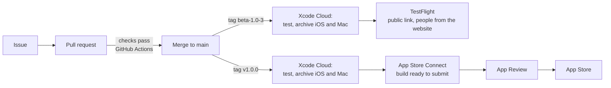

# Release process

How a change gets from a merged PR to testers and then the App Store. Decided 20 Oct 2026. **Status: agreed, set-up pending** (the Xcode Cloud steps at the end are not done yet).

The short version: **`main` is always releasable. Nothing reaches testers by merging. A tag does.** Builds are made, signed and uploaded by **Xcode Cloud**; GitHub Actions keeps checking pull requests.

## Who gets what

| Audience | What they get | How |
|---|---|---|
| You | The PR's branch, on your devices | A local build before you merge, as now (Debug, CloudKit **Development**) |
| Testers | A beta build | You push a `beta-*` tag; Xcode Cloud builds it and puts it in the TestFlight group |
| Everyone | A release | You push a `v*` tag; Xcode Cloud builds it and uploads it for App Store submission |

Because testers include people from the website, TestFlight is opened with a **public link** to an **external** group. That has consequences the checklist below covers: Apple reviews the build, the data is real, and the iCloud schema is permanent.

## Versions, builds and tags

- **Marketing version** (`1.0`, `1.1`, `1.1.1`): changed by hand in the project, only when a new version starts. Semantic: a new feature is a minor bump, a fix is a patch.
- **Build number:** never set by hand. Xcode Cloud numbers each build (`CI_BUILD_NUMBER`) and a number can't be reused, so a re-run is always a new build. *Check on the first run that the number comes from Xcode Cloud and not the project's `1`.*
- **Beta tags:** `beta-<version>-<n>`, for example `beta-1.0-3` (the third beta of 1.0). Starts a TestFlight build.
- **Release tags:** `v<version>`, for example `v1.0.0`. Starts the App Store build, and marks what shipped, so a hotfix can start from it.
- Tags are made on `main`, on a commit whose pull-request checks were green. Never tag a branch.

## Xcode Cloud workflows

Two workflows, each started by a tag (the names are chosen so one tag can never start both).

| | **TestFlight beta** | **App Store release** |
|---|---|---|
| Starts on | Tag changes: name **starts with** `beta-` | Tag changes: name **starts with** `v` |
| Environment | Xcode **latest release** (27.x), macOS latest release | the same |
| Scheme | `Jamaal` | `Jamaal` |
| Actions | **Archive – iOS** and **Archive – macOS**, each with *Distribution Preparation* = **App Store Connect** | the same |
| Post-actions | **TestFlight External Testing** to the public group (and **Internal Testing** to you, so you see it first) | **Internal Testing** only; you submit from App Store Connect |
| Tests | none | none |

**Tests are not run here.** The unit tests and the UI tests run on every pull request in GitHub Actions, and a tag is only ever put on a commit whose checks were green, so running them again would only slow and cost a build. (If that changes, add a *Test* action with `JamaalTests`; the UI tests are too slow and too flaky to gate a release on.)

Signing is cloud-managed, so no distribution certificate lives on your Mac. The iPhone, iPad and Mac come from one App Store Connect record (`dev.fhdamd.Jamaal`). The repository and ThreadsKit are public, so no extra repository access is needed.

**The scheme must be shared.** Xcode Cloud only lists *shared* schemes. This repo does not track one on purpose (a tracked shared scheme stops Xcode generating the automatic `Jamaal` scheme the GitHub CI uses, which broke CI once), and the local one has personal debug launch arguments. If `Jamaal` isn't offered when the workflow is made, the fix is to track a **clean** `Jamaal.xcscheme` (build, archive and the unit-test target, no launch arguments) and keep using it for both CI and Xcode Cloud; that needs everyone with a local `Jamaal.xcscheme` to move it aside before pulling. Decide when it comes up; don't add it ahead of need.

**What testers are told:** the repo's `TestFlight/WhatToTest.en-US.txt` is shown as "What to Test" (Xcode Cloud reads that file). Update it in the PR that makes the build worth testing, in plain words, so a tag is never held up for it.

## Before you push a tag

A short checklist; the first two have no undo.

1. **CloudKit schema.** If any model changed since the last tag, **deploy the schema from Development to Production** in the CloudKit console first, and check the new fields are there. A build that uses a field Production doesn't have fails to sync. Once deployed it is permanent: Production can gain types and fields, never lose or rename them. So model changes are **additive only** from here, and the move to SwiftData's versioned schemas happens before the first change that isn't.
2. **Data you can't take back.** Public testers' data lives in the **Production** container, the same one the App Store release uses. Never reset it, and never ship a change that would drop or rewrite it without a migration.
3. **Version.** A new version string needs bumping in the project; a repeat beta of the same version doesn't.
4. **Checks green** on the merged commit, and the PR template's schema question answered.
5. **`WhatToTest` updated.**
6. **Purchases.** Subscriptions are not set up for the first betas, so a **TestFlight build keeps full access with no trial and never goes read-only** (Settings shows *Beta · full access*); an App Store build keeps the 14-day trial and the read-only rules. **When the App Store version goes live the trial starts for each person on their first launch of it**, beta testers included: a TestFlight build never sets the trial's start date (it syncs through the same production iCloud container), and the first launch of a non-beta build claims it, once (#291). The app tells them apart by the build's receipt (`sandboxReceipt`), which is also why the trial and paywall can only be seen in a real TestFlight build. The plan for turning subscriptions on is in [TestFlight readiness](testflight-readiness).
7. **Beta App Review (first build of each version).** An external group needs Apple's beta review, usually about a day: it needs the test notes (the beta has full access with no sign-in and no payment, and subscriptions aren't switched on yet), the support URL (https://jamaal.app/support), the privacy URL (https://jamaal.app/privacy) and a contact. Later builds of the same version are usually quick to pass. Don't tag something you can't afford to wait a day for.

## After the tag

- Watch the Xcode Cloud run: tests, archive, upload. A failed test stops the build, and nothing is uploaded.
- When App Store Connect finishes processing (a few minutes), install it from TestFlight on your own devices **before** telling anyone, and add something on one device to check it reaches another (Production sync is different from the Debug sync you test locally).
- A TestFlight build **expires after 90 days**, so a long gap needs a fresh beta.
- Share the public link once the first build is approved. It can take up to 10,000 testers, and you can pause or close it.

## Local builds are separate

A build from your Mac (Xcode or `xcodebuild`) uses the **Development** iCloud environment, so what you do on your devices is never in TestFlight, and a TestFlight tester's data is never on yours. That is expected: say so to testers if it comes up. Keep testing each PR on your devices before merging, as now.

## Hotfixes

Branch from the release tag, fix and test it through the normal issue and PR, merge to `main`, then tag a patch (`v1.0.1`, and a `beta-1.0.1-1` first if it is risky). A fix that touches the data model needs the schema step above.

## What setting this up taught us (21 Oct 2026)

- **Distribution Preparation: choose *App Store Connect*, not *TestFlight (Internal Testing Only)*.** The choices are exclusive (there is no "both"), and a build made with the internal-only option can **never** be added to an external group or the public link. It cannot be changed afterwards: you need a new build. App Store Connect does not publish anything by itself; the build is uploaded and you decide where it goes.
- **An internal tester's invite email may not arrive** (it did not, even after *Resend Invite*), and until it is accepted the tester stays *Invited* and TestFlight shows only the redeem-code screen. Don't build the plan on it: the **external group with a public link** worked without any email, and it is what website testers use.
- **The external group needs the Test Information saved first** (the beta description, a feedback email, contact details and the review notes), and the first build of each version waits for **Beta App Review** (about a day).
- **Each new build needs adding to the external group** unless the workflow has the *TestFlight External Testing* post-action for it.
- **Xcode Cloud numbers the builds itself** (the first run was build 1) and posts each archive on the commit in GitHub, with its warnings count, so GitHub shows whether a tag's build worked.
- **Keep an eye on the Start Conditions.** *Branch Changes* builds and uploads on every merge to `main`; the plan is *Tag Changes* starting `beta-`.

## One-time setup

1. **App Store Connect:** the app record (iOS and macOS, bundle id `dev.fhdamd.Jamaal`). *Done (21 Oct 2026).*
2. **Connect Xcode Cloud (you):** in Xcode, open the project, **Report navigator** (⌘9) → **Cloud** tab → **Get Started** (or *Create Workflow*). Choose the **Jamaal** product, sign in to GitHub when asked and allow the Xcode Cloud app access to `fahadahmed/jamaal-app` only.
3. **Create the two workflows** with the table above. In the workflow editor: *Environment* (Xcode and macOS versions), *Start Conditions* (delete the default branch condition and add **Tag Changes**), *Actions* (+ **Archive**, once for iOS and once for macOS, scheme `Jamaal`), *Post-Actions* (+ **TestFlight Internal Testing** and **External Testing**, picking the groups).
4. **TestFlight (you):** an external group with the public link on, plus the test details, the support and privacy URLs, and a contact (see the checklist above).
5. **First run:** push `beta-1.0-1` on a commit you've tested, then confirm the build number, the TestFlight upload and the Mac build all work, and that the scheme was found. Fix anything before the website link goes out.
6. **Repository:** `TestFlight/WhatToTest.en-US.txt` and the pull-request template are in; `ci_scripts/` stays empty unless a build needs a script.
