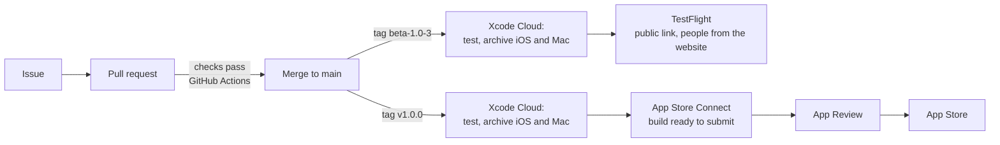

# Release process

How a change gets from a merged PR to testers and then the App Store. Decided 20 Oct 2026. **Status: agreed, set-up pending** (the Xcode Cloud steps at the end are not done yet).

The short version: **`main` is always releasable. Nothing reaches testers by merging. A tag does.** Builds are made, signed and uploaded by **Xcode Cloud**; GitHub Actions keeps checking pull requests.

## Who gets what

| Audience | What they get | How |
|---|---|---|
| You | The PR's branch, on your devices | A local build before you merge, as now (Debug, CloudKit **Development**) |
| Testers | A beta build | You push a `beta-*` tag; Xcode Cloud builds it and puts it in the TestFlight group |
| Everyone | A release | You push a `v*` tag; Xcode Cloud builds it and uploads it for App Store submission |

Because testers include people from the website, TestFlight is opened with a **public link** to an **external** group. That has consequences the checklist below covers: Apple reviews the build, the data is real, and the iCloud schema is permanent.

## Versions, builds and tags

- **Marketing version** (`1.0`, `1.1`, `1.1.1`): changed by hand in the project, only when a new version starts. Semantic: a new feature is a minor bump, a fix is a patch.
- **Build number:** never set by hand. Xcode Cloud numbers each build (`CI_BUILD_NUMBER`) and a number can't be reused, so a re-run is always a new build. *Check on the first run that the number comes from Xcode Cloud and not the project's `1`.*
- **Beta tags:** `beta-<version>-<n>`, for example `beta-1.0-3` (the third beta of 1.0). Starts a TestFlight build.
- **Release tags:** `v<version>`, for example `v1.0.0`. Starts the App Store build, and marks what shipped, so a hotfix can start from it.
- Tags are made on `main`, on a commit whose pull-request checks were green. Never tag a branch.

## Xcode Cloud workflows

Two workflows, each starting on a tag (the tag's name *starts with* `beta-` or `v`; they can't both match one tag).

| Workflow | Starts on | Does | Ends in |
|---|---|---|---|
| **TestFlight** | tag starts with `beta-` | Runs the JamaalCore and app unit tests; archives **iOS** and **macOS** | Uploads and adds the build to the external TestFlight group |
| **App Store** | tag starts with `v` | The same tests and archives | Uploads to App Store Connect, no group; you submit it by hand |

Signing is cloud-managed, so no distribution certificate lives on your Mac. The iPhone, iPad and Mac come from one App Store Connect record (`dev.fhdamd.Jamaal`).

**What testers are told:** the repo's `TestFlight/WhatToTest.en-US.txt` is shown as "What to Test" (Xcode Cloud reads that file). Update it in the PR that makes the build worth testing, in plain words, so a tag is never held up for it.

## Before you push a tag

A short checklist; the first two have no undo.

1. **CloudKit schema.** If any model changed since the last tag, **deploy the schema from Development to Production** in the CloudKit console first, and check the new fields are there. A build that uses a field Production doesn't have fails to sync. Once deployed it is permanent: Production can gain types and fields, never lose or rename them. So model changes are **additive only** from here, and the move to SwiftData's versioned schemas happens before the first change that isn't.
2. **Data you can't take back.** Public testers' data lives in the **Production** container, the same one the App Store release uses. Never reset it, and never ship a change that would drop or rewrite it without a migration.
3. **Version.** A new version string needs bumping in the project; a repeat beta of the same version doesn't.
4. **Checks green** on the merged commit, and the PR template's schema question answered.
5. **`WhatToTest` updated.**
6. **Purchases.** The first betas keep subscriptions off (everyone is on the 14-day trial); the flag and the plan are in [TestFlight readiness](testflight-readiness).
7. **Beta App Review (first build of each version).** An external group needs Apple's beta review, usually about a day: it needs the test notes (how the app-managed trial and read-only work, no sign-in, no payment), the support URL (https://jamaal.app/support), the privacy URL (https://jamaal.app/privacy) and a contact. Later builds of the same version are usually quick to pass. Don't tag something you can't afford to wait a day for.

## After the tag

- Watch the Xcode Cloud run: tests, archive, upload. A failed test stops the build, and nothing is uploaded.
- When App Store Connect finishes processing (a few minutes), install it from TestFlight on your own devices **before** telling anyone, and add something on one device to check it reaches another (Production sync is different from the Debug sync you test locally).
- A TestFlight build **expires after 90 days**, so a long gap needs a fresh beta.
- Share the public link once the first build is approved. It can take up to 10,000 testers, and you can pause or close it.

## Local builds are separate

A build from your Mac (Xcode or `xcodebuild`) uses the **Development** iCloud environment, so what you do on your devices is never in TestFlight, and a TestFlight tester's data is never on yours. That is expected: say so to testers if it comes up. Keep testing each PR on your devices before merging, as now.

## Hotfixes

Branch from the release tag, fix and test it through the normal issue and PR, merge to `main`, then tag a patch (`v1.0.1`, and a `beta-1.0.1-1` first if it is risky). A fix that touches the data model needs the schema step above.

## One-time setup (not done yet)

1. **App Store Connect:** create the app record (iOS and macOS, bundle id `dev.fhdamd.Jamaal`) *(you)*.
2. **Xcode Cloud:** in Xcode, Report navigator → Cloud → connect the GitHub repository and allow access *(you; needs your Apple and GitHub sign-in)*.
3. **Workflows:** create the two above *(the settings can be made together; the sign-in steps are yours)*.
4. **TestFlight group:** an external group with the public link on, plus the test details and URLs above *(you)*.
5. **Repository:** `ci_scripts/` (reserved) gets a post-clone script only if the build needs one; add `TestFlight/WhatToTest.en-US.txt`; add the schema question to the PR template *(this PR adds the template)*.
6. **First run:** push a `beta-` tag on a commit you've tested, then confirm the build number, the TestFlight upload and the Mac build all work. Fix anything before the website link goes out.
